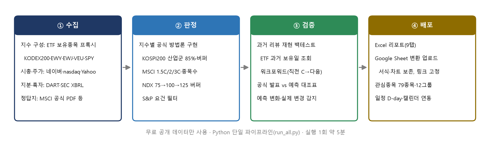
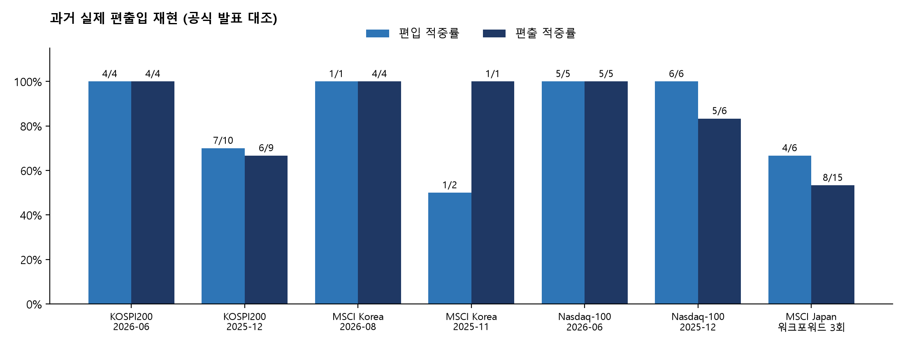
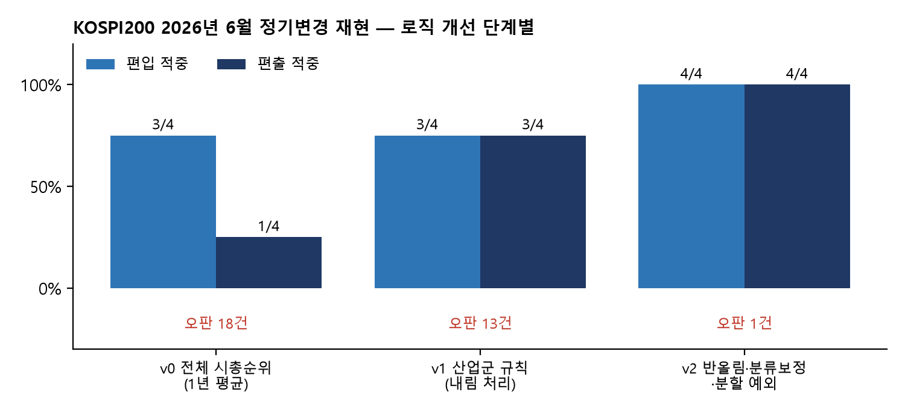
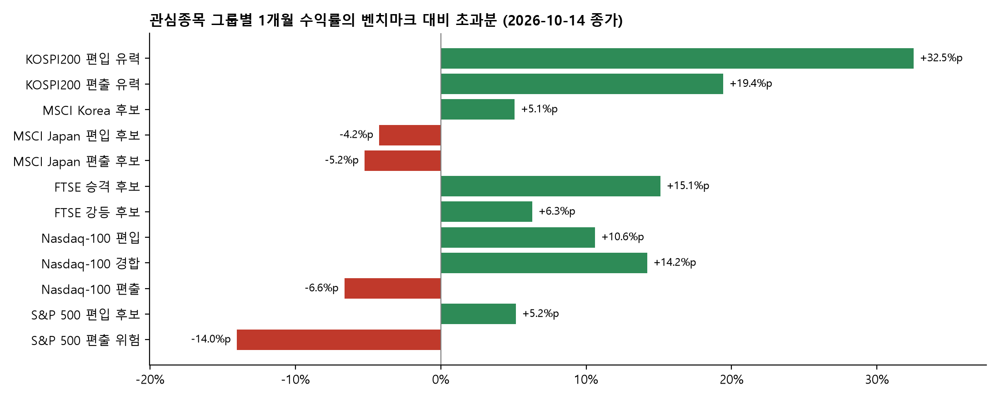

# 지수 편입·편출 예측 트래커 - KOSPI200 · MSCI · FTSE · Nasdaq-100 · S&P 500

패시브 자금은 지수 정기변경일 종가에 편입 종목을 사고 편출 종목을 팝니다. 이 프로젝트는 **6개 지수의 공식 방법론을 코드로 옮겨 발표 전에 편입·편출 종목을 예측**하고, 과거 리뷰를 재현하는 백테스트와 발표 후 공식 대조로 정확도를 기록합니다. 유료 단말 없이 ETF 보유종목 공시·거래소 API·DART·SEC XBRL 같은 공개 소스만 씁니다.

**대시보드(HTML):** https://dhpark19955-code.github.io/index-inclusion-tracker/ - 공식 발표 대조, 예측 스냅샷, 백테스트, 리뷰 일정 D-day

**패시브 수급 트래커(HTML):** https://dhpark19955-code.github.io/index-inclusion-tracker/passive.html - 편입·편출 종목의 예상 패시브 매수·매도 금액(예상 비중 × 추종 ETF 하한 AUM)과 소화일수, KODEX 200 설정·환매로 본 종목별 실제 패시브 순매수(5·20·60일). ETF 하한은 공개 ETF 보유내역으로 집계한 최소치이고, 업계 전체 환산은 추론값입니다. 운영본에서 생성해 수동으로 갱신합니다.

| 항목 | 내용 |
|---|---|
| 지수 | KOSPI200 · MSCI Korea · MSCI Japan · FTSE All-World Korea · Nasdaq-100 · S&P 500 |
| 유니버스 | 국내 전종목(네이버 시총순위) · 미국 전종목(nasdaq.com 스크리너) · 일본 시총 ¥1,500억 이상 - 약 1만 종목 |
| 백테스트 | 과거 리뷰 7회 재현: 실제 편입·편출 78건 중 61건 일치 (Nasdaq-100 2026-06 10/10, KOSPI200 2026-06 8/8) |
| 발표 대조 | KOSPI200 2026-12 정기변경(11-18 발표): 편입 8/11 · 편출 9/12 포착, 유력 판정 9건 중 8건 적중 |
| 규모 | Python 스크립트 23개 약 3,900줄, `run_all.py` 하나로 수집 → 판정 → 리포트. 사람이 고치는 값은 전부 `data/overrides/*.csv` |

## 결과물

| 결과물 | 위치 | 내용 |
|---|---|---|
| HTML 대시보드 | [`index.html`](index.html) + [`data.json`](data.json) | 정적 페이지. `scripts/build_site_data.py` 가 스냅샷·일정·공식 발표를 모아 data.json 생성 |
| 예측 스냅샷 | [`data/snapshots/20261014/`](data/snapshots/20261014/) | 구성종목 7개 지수, 유니버스 2개, 지수별 스크린 결과, 최종 판정 `predictions.csv` 170건 |
| 공식 발표 대조 | [`data/overrides/official_changes.csv`](data/overrides/official_changes.csv) | 발표된 편입·편출을 넣으면 `run_all` 과 대시보드가 적중 대조표를 만듦 |
| Excel 리포트 | [`output/지수편입_트래커_20261014.xlsx`](output/) | 요약·일정·지수별 상세·방법론 9개 탭 (실행 산출물 그대로) |
| 관심종목 워크북 | [`output/관심종목_지수편입_20261014.xlsx`](output/) | 판정에서 자동 선별한 79종목·12그룹의 1주·1개월·3개월 수익률, 벤치마크 초과, 차트 |
| 백테스트 | [`scripts/backtest_kospi200.py`](scripts/backtest_kospi200.py) · [`backtest_msci.py`](scripts/backtest_msci.py) · [`backtest_ndx.py`](scripts/backtest_ndx.py) · [`backtest_sp.py`](scripts/backtest_sp.py) | 과거 리뷰 직전 구성·시총을 복원해 공식 변경 목록과 대조 |
| 포트폴리오 문서 | [`docs/지수편입트래커_포트폴리오_박도현.pdf`](docs/지수편입트래커_포트폴리오_박도현.pdf) | 11쪽: 문제·구조·지수별 로직·백테스트·개발 과정·한계 |



## 2026-11-18 공식 발표 대조 - 10-14 스냅샷이 맞혔나

**사실**은 발표 명단과 스냅샷 판정, **해석**은 마지막 문단입니다. 대조 로직은 `scripts/build_site_data.py`, 결과는 `data.json` 의 `reviews`.

### KOSPI200 2026-12 정기변경 (11-18 발표, 12-11 효력)

| 구분 | 공식 발표 | 스냅샷 판정(10-14) | 결과 |
|---|---|---|---|
| 편입 11 | 가온전선, 대덕전자, 일진전기, 삼아알미늄 | 편입 유력 | 4/4 적중 |
| | 두산퓨얼셀, 서울보증보험, 효성, 한국쉘석유 | 편입 경합 (두 산업분류 중 한쪽만 통과) | 4건 포착 |
| | PI첨단소재, 현대지에프홀딩스, SK네트웍스 | 판정 없음 | 3건 미포착 |
| 편출 12 | SK아이이테크놀로지, 한화머시너리앤서비스홀딩스, 코스모화학, 율촌화학 | 편출 유력 | 4/4 적중 |
| | 대한유화, TKG휴켐스, 아세아, 한샘, 대상 | 편출 위험 (한쪽 분류만) | 5건 포착 |
| | 지역난방공사, OCI, 영풍 | 판정 없음 | 3건 미포착 |
| 유력인데 빗나감 | SK가스 (편입 유력) | | 1건 |
| 경합·위험 중 미실현 | | 경합 6건 + 위험 10건 | 16건 |

요약: 편입 8/11 · 편출 9/12 포착. '유력' 9건 중 8건 적중, 유력 오판은 SK가스 1건. '경합·위험' 25건 중 9건이 실현돼, 경합 등급은 "후보 풀"로 읽는 것이 맞습니다.

### MSCI Korea 2026-11 반기리뷰 (11-12 발표)

스탠다드 지수 편입·편출 없음(스몰캡만 5 편입·4 편출). 스냅샷의 편입 유력 1건(고려아연)은 미실현 - 요건을 넘고도 4회 연속 미편입이던 종목이라 `kr_notes.csv` 에 "MSCI 개별 판단, 가능성 낮게 볼 것"으로 적어 둔 사례입니다. 편출 위험 1건(유한양행)은 발표 전 주가 반등으로 잔류, 편입 경합 1건(주성엔지니어링)은 미편입.

**해석(추론):** KOSPI200 미포착 6건은 스냅샷(10-14)과 심사기준일(10-30) 사이 3주의 시총·거래대금 변화, 그리고 11-02 시행된 새 산업분류(KRICS) 종목별 공식 분류를 근사로 대신한 영향으로 봅니다. 유력 등급의 정밀도(8/9)는 유지됐고, 다음 리뷰부터는 심사기준일 직후 스냅샷으로 대조합니다.

## 지수별 판정 로직

공식 방법론에서 판정 규칙을 그대로 옮기고, 공개되지 않는 값(기준선·산업 분류·유동주식)만 근사하거나 과거 결과로 역산했습니다.

| 지수 | 결정 방식 | 구현한 규칙 | 근사·역산한 값 | 코드 |
|---|---|---|---|---|
| KOSPI200 | 규칙 (KRX) | 6개월 일평균 시총·거래대금, 산업군별 누적 85%, 기존 110% / 신규 90% 버퍼(인원 반올림), 200개 맞춤, 15거래일 시총 50위 특례, 분할 신설 종목 예외 | 산업군 분류(비공개) - 신·구 두 분류에서 같은 판정일 때만 '유력' | `kospi200_model.py`, `screen_kr.py` |
| MSCI Korea | 규칙 (GIMI) | 편입 시총 ≥ 1.5C · 유동 ≥ 0.5C, 유지 ≥ 2/3C · 1/3C, 외국인 한도 여유 15% / 3.75%, 회전율 | 기준선 C - 증권사 편입선(10.2~13조) ÷ 1.5 → 7.8조, 밴드 밖은 '경합' | `screen_kr.py`, `calibrate_msci.py` |
| MSCI Japan | 규칙 (GIMI) | 한국과 같은 규칙 + 종목 수 조정: 리뷰 후 구성 수 ≈ 유동시총 누적 80% 순위, 부족분만큼 버퍼 하위부터 편출 | C 와 목표 종목 수 - 직전 리뷰 역산 × TOPIX 달러 변화 | `msci_jp.py` |
| FTSE Korea | 규칙 (지역 백분위) | 86% / 92% 백분위를 이론대로 계산하면 호주·대만 유동비율 때문에 한국 절반이 편출로 나옴 → 실제 구성 분포를 앵커로 편입·편출선 | 편출선 = 구성 유동시총 하위 5%, 편입선 = 미승격 상위 5% | `ftse_region.py` |
| Nasdaq-100 | 규칙 (기계적) | 11월 말 순위, 75위 → 76~100위 기존 → 101~125위 버퍼(직전 재구성 100위 이내만) → 충원, 해외 ADR 은 미국 상장분만, Fast Entry | 버퍼 자격 - 직전 재구성 순위 재계산 | `screen_us.py` |
| S&P 500 | 위원회 재량 | 요건 통과 후보 풀만: 시총 하한, 유동비율 ≥ 0.10(SEC 공시 유동시총 현재가 환산), GAAP 최근분기·4분기합 흑자, 상장 12개월, 도미사일, 편출 후 1년 제외 | 2026년 편입 3건 모두 필터 통과, 편출 3건 모두 위험군 포착으로 확인 | `screen_us.py` |

## 백테스트 - 과거 리뷰 재현

정답지는 MSCI 공식 변경목록 PDF, KODEX 200 구성종목 변경 전후 비교, Nasdaq 공식 발표. ETF 보유종목을 과거 날짜로 조회해 리뷰 직전 구성을 복원하고 당시 가격으로 시총을 다시 계산했습니다. 일본은 결과를 모르는 조건의 워크포워드(직전 리뷰 기준선 × 시장 변화).

| 지수 · 리뷰 | 편입 | 편출 | 해석 |
|---|---|---|---|
| KOSPI200 2026-06 | 4/4 | 4/4 | 오판 1건. 산업군 규칙이 결과를 결정 |
| KOSPI200 2025-12 | 7/10 | 6/9 | 놓친 종목은 대부분 합병·분할 수시변경과 겹친 경우 |
| MSCI Korea 2026-08 | 1/1 | 4/4 | 편출 4건 중 2건은 유동시총 미달 - 규칙 그대로 재현 |
| MSCI Korea 2025-11 | 1/2 | 1/1 | 놓친 1건은 편입선 바로 아래 '경합' |
| Nasdaq-100 2026-06 | 5/5 | 5/5 | 분기 변경(125위 밖 편출) 완전 재현 |
| Nasdaq-100 2025-12 | 6/6 | 5/6 | 놓친 BIIB 가 버퍼 자격 규칙을 드러내 모델에 반영 |
| MSCI Japan 워크포워드 3회 | 4/6 | 8/15 | 종목 수 조정 규칙으로 편출 5/15 → 8/15, 남은 오차는 유동주식 데이터 품질 |



## 개발 과정 - 무엇이 틀렸고 어떻게 고쳤나

처음부터 맞힌 모델은 없었습니다. 백테스트가 틀린 지점을 보여줬고, 그때마다 공식 원문이나 데이터로 원인을 확인해 고쳤습니다.

| 문제 | 발견 계기 | 해결 | 효과 |
|---|---|---|---|
| KOSPI200 을 전체 시총 순위로 판정 | 6월 재현에서 169위 종목 편출·284위 종목 편입을 반대로 예측 | KRX 방법론 원문 → 6개월 평균·산업군 내 순위·버퍼 규칙 구현 | 오판 18 → 13건 |
| 110% / 90% 한도를 내림 처리 | 경계 종목 3개가 실제와 반대 | 반올림 + 업종 오분류 보정 + 분할 신설 예외 | 편입 4/4 · 편출 4/4, 오판 1건 |
| MSCI 기준선을 시장 커버리지로 단순 계산 | 1년 새 기준선이 4배로 뛰어 과거 결과 설명 불가 | 증권사 편입선을 GIMI 배수로 역산 + 민감도 밴드 | 8월 편입 1/1 · 편출 4/4 |
| 외국인 한도 여유 계산 오류 | 한도가 꽉 찬 통신주가 편입 유력으로 표시 | 포털 '소진율' 필드가 실제로는 보유율임을 확인 → 법정 한도표 도입 | MSCI·FTSE 오판 제거 |
| Nasdaq-100 버퍼를 무조건 적용 | 2025-12 재현 1건 미적중 | 버퍼 자격(직전 재구성 100위 이내) 확인 → 과거 순위 재계산 | 자격 없는 기존 종목 2개를 편출 유력으로 재분류 |
| FTSE 지역 백분위를 이론대로 계산 | 한국 구성종목 절반이 편출로 나옴 | 실제 구성·소형지수 분포를 앵커로 한 기준선 | 후보군 정상화 |
| MSCI Japan 편출을 시총으로만 판정 | 5월 편출 11건 중 2건만 적중 | 리뷰 후 종목 수 = 커버리지 80% 순위임을 발견 → 종목 수 조정 | 2/11 → 5/11 |
| 데이터 품질 | 장중 미완성 일봉, 장중 순위 중복, 비슷한 회사명 오매칭, ETF 잔여 1주 보유분 | 마감 전 저장분 제외, 중복 제거, 엄격 매칭, 비중 0.02% 미만 제외 | 재발 방지 로직을 코드에 고정 |



## 아이디어 - 판정을 관심종목과 수익률로 연결

판정 결과를 그대로 두지 않고 `watchlist.py` 가 **편입 유력 · 편출 유력 · 경합** 그룹별 관심종목으로 자동 등록해, 처음 잡힌 날의 가격을 보존하고 1주·1개월·3개월 수익률과 벤치마크(KOSPI·Nasdaq-100·S&P 500) 대비 초과수익을 매일 계산합니다. 발표일 D-day 를 같은 표에 붙여 "언제까지 들고 갈지"를 한 화면에서 보게 했습니다.



10-14 시점 KOSPI200 편입 유력 그룹은 1개월 벤치마크 대비 +32.5%p, 편출 유력 그룹도 +19.4%p 였습니다. 편입 후보는 발표 전에 이미 많이 올라 있고 편출 후보도 약세가 아니었다는 것은, 패시브 수급을 노린다면 **발표 뒤 리밸런싱일까지의 구간**을 따로 봐야 한다는 뜻입니다(추론).

## 데이터 소스 - 막힌 경로와 우회

전부 비공식 엔드포인트라 행 수 검증을 붙여 씁니다. 키는 선택이고, 없어도 실행됩니다.

| 용도 | 소스 | 비고 |
|---|---|---|
| 지수 구성종목 | KODEX 200 구성종목 공시(과거 날짜 조회 가능), iShares EWY·EWJ·IJH, Vanguard VEU·VSS, nasdaq.com, SPDR SPY | ETF 보유종목을 지수 프록시로. 편출 뒤 잔여 1주·임시코드 행은 비중 0.02% 미만 제외 |
| 정답지 | MSCI 공식 변경목록 PDF(`app2.msci.com/eqb/gimi/stdindex/`), KODEX 변경 전후, Nasdaq·S&P 발표 | EWY 복원보다 공식 PDF 가 정본 |
| 시세·시총 | 네이버 시총순위·일봉(siseJson), nasdaq.com 스크리너, Yahoo Finance | 장중 실행 시 순위 중복·미완성 봉 → 마감 후 실행, 15:40 전엔 당일 봉 제외 |
| 지분·실적 | DART 최대주주·자기주식, SEC XBRL companyconcept(GAAP 순이익), 10-K 표지 유동시총(dei:EntityPublicFloat) | 유동비율·흑자 요건. 포털 '외국인소진율'은 보유율이라 법정 한도표(`kr_fol.csv`) 별도 |
| 막힘 → 우회 | KRX 정보데이터시스템 로그인벽 → ETF 공시·네이버 / msci.com 봇 차단 → 공식 PDF 직접 경로 / 유료 API 구성종목 → ETF 보유종목 | 모두 실측 후 채택. KRX Open API 는 API 별 승인 전엔 401 |

## 실행

```bash
pip install -r requirements.txt
python -I -X utf8 scripts/run_all.py              # 수집 + 스크린 + Excel 리포트 + 관심종목 (5~10분)
python -I -X utf8 scripts/run_all.py --no-fetch   # 오늘 스냅샷으로 리포트만
python -I -X utf8 scripts/build_site_data.py      # data.json 재생성 (대시보드)
python -m http.server 8000                        # index.html 을 로컬에서 확인 (file:// 는 fetch 가 막힘)
python -I -X utf8 scripts/backtest_kospi200.py    # 백테스트 (backtest_msci / backtest_ndx / backtest_sp 도 같은 방식)
```

- 사람이 고치는 값은 전부 `data/overrides/`: `calendar.csv`(일정), `kr_params.csv`(KOSPI200 순위·MSCI 기준선), `kr_fol.csv`(외국인 한도), `krics_fix.csv`·`gics10_fix.csv`(산업분류 보정), `us_overrides.csv`(미국 예외), `broker_predictions.csv`(증권사 예상), `official_changes.csv`(공식 발표 → 적중 대조), `kr_notes.csv`(개별 메모).
- 원본 운영본은 Google Sheet 2개(트래커·관심종목)에 서식·차트를 유지한 채 매회 같은 파일 ID 로 변환 업로드했습니다. 공개판은 그 단계를 뺐고, `GSHEET_PUSH_CMD` 환경변수로 외부 업로드 명령을 붙일 수 있습니다.
- `scripts/common.py` 의 `ENV_PATH`(기본 저장소 루트 `.env`)에 `KRX_API_KEY` 등을 두면 읽고, 없으면 공개 경로만 씁니다. 값은 로그에 찍지 않습니다.

## 폴더 구조

```
index.html, data.json      대시보드 (GitHub Pages)
passive.html               패시브 수급 트래커 (데이터 내장 단일 파일, GitHub Pages)
scripts/                   수집(fetch_*) → 지표(kr_metrics, ftse_region) → 판정(kospi200_model, screen_kr, screen_us, msci_jp)
                           → 변화 감지(diffs, events) → 리포트(build_report, watchlist) → run_all / backtest_* / build_site_data
data/overrides/            사람이 고치는 입력 CSV 9개
data/snapshots/20261014/   구성종목·유니버스·스크린·predictions.csv (재현용 원본)
output/                    Excel 리포트·관심종목 워크북 (2026-10-14 실행분)
docs/                      포트폴리오 PDF, 그림
```

## 한계

- 한국 과거 일평균 시총은 과거 종가 × 현재 주식수 근사(증자·소각 종목 오차). 해외 유동주식은 무료 소스 품질이 낮아 MSCI Japan 오차의 주원인.
- KOSPI200 새 산업분류(KRICS) 종목별 공식 결과는 근사 매핑으로 대신했고, 이번 12월 변경의 미포착 6건에 영향을 줬다고 봅니다(추론).
- S&P 500 위원회 선택과 MSCI 개별 판단(요건을 넘고도 미편입)은 모델 밖이라 `kr_notes.csv`·`us_overrides.csv` 메모로 관리.
- Nasdaq-100 101~125위 버퍼 자격은 직전 재구성 순위를 근사 재계산한 값.
- 예측은 모델 추정이며 투자 권유가 아닙니다.

## 일하는 원칙

- 공식 원문 우선. 틀리면 원문이나 데이터로 원인을 확인한 뒤 규칙을 고치고, 고친 규칙은 백테스트로 다시 확인.
- 모든 판정에 근거 수치를 노출하고, 사실(발표·수치)과 추론(해석)을 구분해 씁니다.
- 로그인 벽·봇 차단은 우회하지 않고 공개 대체 소스를 찾습니다. 키와 개인 경로는 코드에 두지 않습니다.
